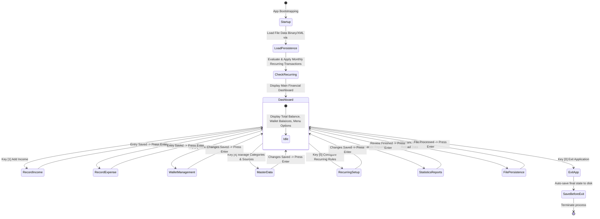

# CLI DASHBOARD & USER INTERFACE SPECIFICATION
## Project: Personal Finance Manager (C++)
**Course:** Introduction to Programming / Introduction to Computer Science (CS160) - APCS  
**Department:** Department of Software Engineering - FIT - VNU-HCMUS  
**Module:** UI / Planning  
**Assignee:** Nguyen Quoc Thinh (Student ID: 25125066) - Group 6  

---

## 1. CORE DESIGN PRINCIPLES

This specification operationalizes all User Interface (UI) and Navigation requirements outlined in the official course project guidelines:

1. **Dashboard as the Central Hub (Single Source of Truth):**
   - Upon launching, the application displays an aggregate financial overview containing:
     - **Total Balance:** The aggregate sum of money available across all active wallets.
     - **Wallet Balances:** A detailed tabular breakdown showing current balances and status for each individual wallet.
     - **System Startup Notification:** Displays automated verification and processing logs for monthly recurring transactions.
     - **Numeric Navigation Menu:** Clean access points to all sub-modules.
2. **Automated Navigation Flow:**
   - As mandated by *Section 1.2 Navigation Flow* in the project specification: **Upon completion of any specific task** (recording an income/expense, configuring master data categories, generating financial reports, or saving data), the application informs the user of the execution status, waits for an acknowledgment keypress (`Press [Enter] to continue...`), and **automatically navigates back to the Dashboard (Main Screen)**.
3. **Strict Separation Between Stored ID and Display Name:**
   - The underlying data structures strictly store primary identifiers (`Source ID`, `Category ID`, `Wallet ID`) for programmatic logic.
   - The user-facing CLI presentation strictly displays human-readable names (`Source Name`, `Category Name`, `Wallet Name`).
4. **Automated Recurring Cycle Check:**
   - On every application launch, the system automatically checks the current monthly cycle. If recurring transactions are due and have not yet been applied for this cycle, they are posted immediately and reported on the Dashboard startup log.
5. **Console Layout Standards (80–100 Columns):**
   - Clean ASCII and box-drawing borders, tabular alignment, and standardized currency formatting with thousands separators and two decimal places (`xx,xxx,xxx.00 VND`).

---

## 2. MAIN DASHBOARD WIREFRAME (MAIN SCREEN)

Screen rendered immediately after application startup and file data deserialization:

```text
========================================================================================
                      PERSONAL FINANCE MANAGER - DASHBOARD CLI
                   Faculty of Information Technology - VNU-HCMUS
========================================================================================
 System Date & Time: 05/11/2026 19:30                Active Cycle: November 2026
----------------------------------------------------------------------------------------
 [!] SYSTEM STARTUP LOG:
  -> Application state successfully loaded from: 'finance_data.bin'
  -> Automated Recurring Transactions processed for November 2026:
     [+] Income  [Monthly Salary] : +15,000,000.00 VND -> Wallet: Techcombank Debit
     [-] Expense [House Rent]     :  -5,000,000.00 VND -> Wallet: Techcombank Debit
----------------------------------------------------------------------------------------
                             FINANCIAL SUMMARY OVERVIEW
+--------------------------------------------------------------------------------------+
|  TOTAL AGGREGATE BALANCE:                                        28,450,000.00 VND   |
+--------------------------------------------------------------------------------------+
|  No. | Wallet ID   | Wallet Name         | Current Balance (VND)  | Status           |
|------+-------------+---------------------+------------------------+------------------|
|  01  | W_CASH      | Physical Cash       |       3,450,000.00     | Active           |
|  02  | W_TCB       | Techcombank Debit   |      18,500,000.00     | Active           |
|  03  | W_MOMO      | MoMo E-Wallet       |       1,500,000.00     | Active           |
|  04  | W_SAVING    | Bank Savings        |       5,000,000.00     | Active           |
+--------------------------------------------------------------------------------------+

================================== MAIN NAVIGATION MENU =================================
  [1] Record Income Transaction       (Add daily revenue/deposit)
  [2] Record Expense Transaction      (Add daily expense/payment)
  [3] Wallet Management               (Add / Edit / Remove Wallets)
  [4] Master Data Management          (Expense Categories & Income Sources)
  [5] Recurring Transactions Setup    (Monthly Automation Rules)
  [6] Statistics & Financial Reports  (Time, Wallet, Multi-Year Analytics)
  [7] Data Persistence                (Save to Disk / Reload File)
  [0] Exit Application
========================================================================================
 [?] Enter your selection (0 - 7): _
```

---

## 3. DETAILED SUB-SCREEN WIREFRAMES

### 3.1. Record Expense Screen
Follows requirement: Stores `Category ID` & `Wallet ID`, displays `Category Name` & `Wallet Name`.

```text
========================================================================================
                 PERSONAL FINANCE MANAGER > RECORD EXPENSE TRANSACTION
========================================================================================
 Available Expense Categories:
   [1] EC_FOOD     : Food & Dining
   [2] EC_TRANS    : Transportation & Fuel
   [3] EC_RENT     : House Rent
   [4] EC_SHOP     : Personal Shopping
   [5] EC_BILLS    : Utility Bills (Electricity, Water, Internet)

 Available Payment Wallets:
   [1] W_CASH      : Physical Cash (Current Balance: 3,450,000.00 VND)
   [2] W_TCB       : Techcombank Debit (Current Balance: 18,500,000.00 VND)
   [3] W_MOMO      : MoMo E-Wallet (Current Balance: 1,500,000.00 VND)
----------------------------------------------------------------------------------------
 [INPUT FORM]
  * Execution Date (DD/MM/YYYY) [Press Enter for today: 05/11/2026]: 05/11/2026
  * Select Category (Index 1-5 or Code EC_...): 1
    -> Selected: EC_FOOD [Food & Dining]
  * Expense Amount (VND): 45000
  * Select Wallet (Index 1-3 or Code W_...): 3
    -> Selected: W_MOMO [MoMo E-Wallet - Current Balance: 1,500,000.00 VND]
  * Transaction Description: Afternoon milk tea with colleagues
----------------------------------------------------------------------------------------
 [TRANSACTION CONFIRMATION]
   - Type            : EXPENSE
   - Date            : 05/11/2026
   - Category Name   : Food & Dining (Stored ID: EC_FOOD)
   - Deducted Amount : -45,000.00 VND
   - Payment Wallet  : MoMo E-Wallet (Stored ID: W_MOMO)
   - Remaining Balance: 1,455,000.00 VND
   - Notes           : Afternoon milk tea with colleagues

 Confirm and save transaction? [Y/N]: Y
 [SUCCESS] Expense transaction recorded and wallet balance updated successfully!
 [*] Navigating back to Dashboard... (Press [Enter] to continue)
```

---

### 3.2. Record Income Screen
Follows requirement: Stores `Source ID` & `Wallet ID`, displays `Source Name` & `Wallet Name`.

```text
========================================================================================
                 PERSONAL FINANCE MANAGER > RECORD INCOME TRANSACTION
========================================================================================
 Available Income Sources:
   [1] IS_SALARY   : Monthly Salary
   [2] IS_BONUS    : Project / Performance Bonus
   [3] IS_FREELANCE: Freelance Contract
   [4] IS_INTEREST : Bank Savings Interest

 Available Destination Wallets:
   [1] W_CASH      : Physical Cash (Current Balance: 3,450,000.00 VND)
   [2] W_TCB       : Techcombank Debit (Current Balance: 18,500,000.00 VND)
   [3] W_MOMO      : MoMo E-Wallet (Current Balance: 1,455,000.00 VND)
   [4] W_SAVING    : Bank Savings (Current Balance: 5,000,000.00 VND)
----------------------------------------------------------------------------------------
 [INPUT FORM]
  * Transaction Date (DD/MM/YYYY): 05/11/2026
  * Select Income Source (Index or Code): 2
    -> Selected: IS_BONUS [Project / Performance Bonus]
  * Income Amount (VND): 2500000
  * Select Destination Wallet (Index or Code): 2
    -> Selected: W_TCB [Techcombank Debit]
  * Transaction Description: Milestone 1 achievement bonus
----------------------------------------------------------------------------------------
 [SUCCESS] Income of +2,500,000.00 VND added to Techcombank Debit!
 New Wallet Balance: 21,000,000.00 VND.
 [*] Press [Enter] to return to Dashboard...
```

---

### 3.3. Master Data Management Screen
Provides full CRUD capabilities (Add, Edit, Delete) for Expense Categories, Income Sources, and Wallets.

```text
========================================================================================
               PERSONAL FINANCE MANAGER > MASTER DATA MANAGEMENT
========================================================================================
  [1] Manage Expense Categories
  [2] Manage Income Sources
  [3] Manage Wallets
  [0] Return to Dashboard
----------------------------------------------------------------------------------------
 Enter selection: 1

--- CURRENT EXPENSE CATEGORIES ---
+-----+---------------+--------------------------------+-------------------------------+
| No. | Category Code | Category Display Name          | Linked Transactions Count     |
+-----+---------------+--------------------------------+-------------------------------+
|  1  | EC_FOOD       | Food & Dining                  | 18 transactions               |
|  2  | EC_TRANS      | Transportation                 |  7 transactions               |
|  3  | EC_RENT       | House Rent                     |  2 transactions (Recurring)   |
|  4  | EC_SHOP       | Shopping                       |  4 transactions               |
|  5  | EC_BILLS      | Utilities & Internet           |  3 transactions               |
+-----+---------------+--------------------------------+-------------------------------+
 Available Actions:
  [A] Add New Category
  [E] Edit Category Name
  [D] Delete Category (Only permitted if no transactions are linked)
  [0] Return to Dashboard
----------------------------------------------------------------------------------------
 Enter choice: _
```

---

### 3.4. Recurring Transactions Management Screen
Follows requirement: Monthly configuration, mandatory Start Date, optional End Date, duplicate prevention mechanism.

```text
========================================================================================
             PERSONAL FINANCE MANAGER > RECURRING TRANSACTIONS (MONTHLY)
========================================================================================
 Automation Rule: Evaluated automatically upon app startup for the current monthly cycle.
 Never duplicated if an entry for the active cycle has already been processed.

+----+-------+--------------------+-------------------+---------------+------------+------------+-----------+
| ID | Type  | Category / Source  | Target Wallet     | Amount (VND)  | Start Date | End Date   | Last Run  |
+----+-------+--------------------+-------------------+---------------+------------+------------+-----------+
| 01 | Exp   | House Rent         | Techcombank Debit |  5,000,000.00 | 01/01/2026 | [Ongoing]  | 11/2026   |
| 02 | Inc   | Monthly Salary     | Techcombank Debit | 15,000,000.00 | 01/01/2026 | [Ongoing]  | 11/2026   |
| 03 | Exp   | Internet Fiber     | MoMo E-Wallet     |    350,000.00 | 01/06/2026 | 31/12/2026 | 11/2026   |
+----+-------+--------------------+-------------------+---------------+------------+------------+-----------+

 Actions:
  [A] Add Recurring Transaction Rule
  [E] Edit Amount or End Date
  [D] Remove Recurring Rule
  [0] Return to Dashboard
----------------------------------------------------------------------------------------
 Enter choice: _
```

---

### 3.5. Statistics & Reporting Screens
Covers all 5 reporting categories defined in *Section 4. Statistics & Reporting*:

```text
========================================================================================
                  PERSONAL FINANCE MANAGER > STATISTICS & REPORTS
========================================================================================
  [1] Time-based Summary          (Income, Expense, Net Balance: From Date A to B)
  [2] Time & Wallet-based Report  (Breakdown by specific wallet over time range)
  [3] Annual Overview             (Total Income, Expense & Net Balance across Year(s))
  [4] Annual Income Breakdown     (Aggregated totals by each Income Source)
  [5] Annual Expense Breakdown    (Aggregated totals by each Expense Category)
  [0] Return to Dashboard
========================================================================================
 Enter reporting module (0 - 5): _
```

#### A. Time-based Statistics Screen (From Date A to Date B)
```text
========================================================================================
               FINANCIAL SUMMARY REPORT (FROM 01/10/2026 TO 05/11/2026)
========================================================================================
  - Total Period Income   : +22,500,000.00 VND
  - Total Period Expense  : -11,850,000.00 VND
----------------------------------------------------------------------------------------
  => NET CASH FLOW        : +10,650,000.00 VND  [SURPLUS]
========================================================================================
 [*] Press [Enter] to return to Dashboard...
```

#### B. Time & Wallet-based Statistics Screen
```text
========================================================================================
            WALLET EXPENSE BREAKDOWN: [PHYSICAL CASH - W_CASH] (01/11 - 05/11/2026)
========================================================================================
+------------+--------------------+-----------------------+--------------------+
| Date       | Category           | Notes                 | Amount (VND)       |
+------------+--------------------+-----------------------+--------------------+
| 01/11/2026 | Food (EC_FOOD)     | Traditional breakfast |          45,000.00 |
| 02/11/2026 | Transport(EC_TRANS)| Motorbike refueling   |          90,000.00 |
| 04/11/2026 | Food (EC_FOOD)     | Social coffee         |          65,000.00 |
+------------+--------------------+-----------------------+--------------------+
 TOTAL EXPENSES FROM CASH WALLET IN PERIOD:                       200,000.00 VND
 Current Cash Wallet Balance:                                   3,450,000.00 VND
========================================================================================
 [*] Press [Enter] to return to Dashboard...
```

#### C. Annual Multi-Year Overview Screen
```text
========================================================================================
               ANNUAL INCOME & EXPENSE OVERVIEW (MULTI-YEAR SELECTION)
========================================================================================
 Selected Evaluation Years: 2025, 2026

+------+--------------------+--------------------+--------------------+----------------+
| Year | Total Income (VND) | Total Expense(VND) | Net Balance (VND)  | Financial Trend|
+------+--------------------+--------------------+--------------------+----------------+
| 2025 |     180,000,000.00 |     142,500,000.00 |     +37,500,000.00 | Positive Saver |
| 2026 |     195,000,000.00 |     138,200,000.00 |     +56,800,000.00 | High Growth    |
+------+--------------------+--------------------+--------------------+----------------+
 TOTAL |     375,000,000.00 |     280,700,000.00 |     +94,300,000.00 |                |
========================================================================================
 [*] Press [Enter] to return to Dashboard...
```

#### D. Annual Expense Breakdown by Category Screen
```text
========================================================================================
                    ANNUAL EXPENSE BREAKDOWN BY CATEGORY (2026)
========================================================================================
 Total Aggregate Expenses in 2026: 138,200,000.00 VND

+-------------------+----------------------+--------------------+----------------------+
| Category Code     | Category Name        | Total Expense(VND) | Percentage & Graph   |
+-------------------+----------------------+--------------------+----------------------+
| EC_RENT           | House Rent           |      60,000,000.00 | [=============   ] 43.4%
| EC_FOOD           | Food & Dining        |      42,500,000.00 | [=========       ] 30.8%
| EC_BILLS          | Utilities & Internet |      15,200,000.00 | [===             ] 11.0%
| EC_SHOP           | Shopping             |      12,000,000.00 | [==              ]  8.7%
| EC_TRANS          | Transportation       |       8,500,000.00 | [=               ]  6.1%
+-------------------+----------------------+--------------------+----------------------+
 TOTAL                                           138,200,000.00 | 100.0%
========================================================================================
 [*] Press [Enter] to return to Dashboard...
```

---

## 4. SYSTEM NAVIGATION FLOW (STATE DIAGRAM)



---

## 5. TECHNICAL CONSTRAINTS COMPLIANCE

1. **Custom Dynamic Array Container:**
   - Adheres strictly to the project rule prohibiting Standard Template Library (STL) containers (`std::vector`, `std::list`, `std::map`). All lists (`Wallets`, `Transactions`, `Categories`, `Sources`, `Recurring`) are managed through `DynamicArray<T>` using raw pointers and manual memory allocation (`new`, `delete`).
2. **Text Representation:**
   - Standard `std::string` is utilized for descriptions, identifiers, and display names.
3. **File Persistence:**
   - Consistent serialization and deserialization across sessions using standard `<fstream>` in binary or structured format.
